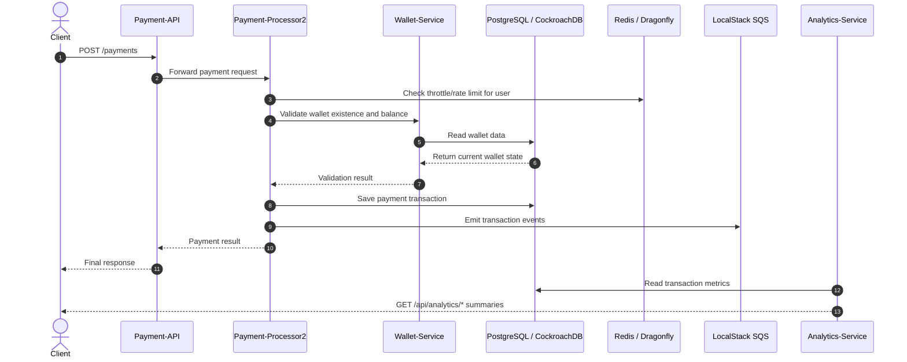

# Simple Payment Minikube

A Java-based microservices demo for a simple payment workflow running on Minikube and Kubernetes. The repository currently implements a small distributed payment platform made up of four Spring Boot services and supporting infrastructure for local development and Kubernetes deployment.

## Current architecture

The codebase now includes:

- Payment-API: public entry point for client requests
- Payment-Processor2: business logic for processing payments and validating wallet balances
- Wallet-Service: wallet creation, lookup, validation, and balance updates
- Analytics-Service: DuckDB-backed analytics API for transaction insights
- PostgreSQL/CockroachDB for transactional data
- Redis / Dragonfly for rate limiting and background processing
- LocalStack for AWS-compatible SQS emulation
- ELK + Fluent Bit for observability



## Services

### 1. Payment-API

Entry point for client requests.

Responsibilities:
- accepts payment requests
- accepts wallet creation requests
- forwards requests to the payment processor
- propagates trace IDs between services

Main class:
- `Payment-API/src/main/java/com/example/processor/demo/PaymentApiApplication.java`

Endpoints:
- `POST /payments`
- `POST /wallets`

Example request:

```json
{
  "paymentId": null,
  "amount": 100.00,
  "currency": "USD",
  "fromUsrId": "alice",
  "toUsrId": "bob"
}
```

### 2. Payment-Processor2

Handles the core payment workflow.

Responsibilities:
- validates payment requests
- applies request throttling with Redis
- checks sender/receiver wallet status
- persists transaction records to PostgreSQL
- emits SQS events for downstream processing
- integrates with JobRunr/Redis-backed background work

Main class:
- `Payment-Processor2/src/main/java/com/example/processor/PaymentProcessorApplication.java`

Key controller:
- `Payment-Processor2/src/main/java/com/example/processor/controller/ProcessorController.java`

Key behavior:
- uses `RestClient` to call the wallet service
- enforces a max-request-per-user threshold in a short sliding window
- stores payment data via Spring Data JPA
- configures AWS SQS via Spring Cloud AWS
- uses Redis and JobRunr for background processing workflows

### 3. Wallet-Service

Owns wallet state and balance logic.

Responsibilities:
- creates wallet records
- fetches wallet balance by user
- validates whether the sender has enough funds
- updates sender and recipient wallet balances
- tracks transaction events

Main class:
- `Wallet-Service/src/main/java/com/example/wallet/WalletApplication.java`

Key controller:
- `Wallet-Service/src/main/java/com/example/wallet/controller/WalletController.java`

Key service:
- `Wallet-Service/src/main/java/com/example/wallet/service/WalletService.java`

Endpoints:
- `POST /wallets`
- `GET /wallets/{userId}`
- `GET /wallets/validate`
- `POST /wallets/update-balance`

### 4. Analytics-Service

Read-optimized analytics layer for payment activity.

Responsibilities:
- ingests payment and wallet events
- stores analytics data in DuckDB
- exposes aggregated payment and processing metrics

Main class:
- `Analytics-Service/src/main/java/com/example/analytics/AnalyticsApplication.java`

Controller:
- `Analytics-Service/src/main/java/com/example/analytics/controller/AnalyticsController.java`

Endpoints:
- `GET /api/analytics/payments/summary`
- `GET /api/analytics/payments/trends`
- `GET /api/analytics/processing`
- `GET /api/analytics/wallets`

## Repository structure

```text
.
├── .github/
│   └── workflows/
│       ├── payment-ci-cd.yml
│       └── qodana_code_quality.yml
├── Analytics-Service/
│   ├── Dockerfile
│   ├── pom.xml
│   └── src/
├── Payment-API/
│   ├── Dockerfile
│   ├── pom.xml
│   └── src/
├── Payment-Processor2/
│   ├── Dockerfile
│   ├── pom.xml
│   └── src/
├── Wallet-Service/
│   ├── Dockerfile
│   ├── pom.xml
│   └── src/
├── k8s/
│   ├── analytics-services.yaml
│   ├── cluster-init.yaml
│   ├── cockroachdb-statefulset.yaml
│   ├── dragonfly.yaml
│   ├── elk-stack.yaml
│   ├── fluent-bit.yaml
│   ├── localstack.yaml
│   ├── payment-apps.yaml
│   ├── payment-database.yaml
│   └── payment-services.yaml
├── pom.xml
├── qodana.yaml
├── README.md
├── .idea/
└── .gitignore
```

## Technology stack

- Java 21
- Maven
- Spring Boot 3.x / 4.x
- Spring Web
- Spring Data JPA
- PostgreSQL
- CockroachDB
- DuckDB
- Redis / Dragonfly
- JobRunr
- Docker
- Kubernetes / Minikube
- LocalStack
- AWS SQS
- ELK stack
- Fluent Bit
- GitHub Actions

## Configuration

### Payment API
`Payment-API/src/main/resources/application.properties`

```properties
spring.application.name=payment-api
server.port=8080
processor.url=http://payment-processor
```

### Payment Processor
`Payment-Processor2/src/main/resources/application.properties`

```properties
spring.application.name=payment-processor
server.port=8080

spring.datasource.url=${DB_URL:jdbc:postgresql://cockroachdb-public:26257/paymentdb?sslmode=disable}
spring.datasource.username=${DB_USER:root}
spring.datasource.password=${DB_PASSWORD:}
spring.datasource.driver-class-name=org.postgresql.Driver
spring.jpa.database-platform=org.hibernate.dialect.PostgreSQLDialect
spring.jpa.hibernate.ddl-auto=update
spring.jpa.show-sql=true

wallet.url=http://wallet-service

sqs.endpoint=${SQS_ENDPOINT:http://localhost:4566}
sqs.queue.name=${SQS_QUEUE_NAME:transaction_wallet}
sqs.queue.txc.failed.name=${SQS_TRANSACTION_FAILED_NAME:transaction_failed_wallet}

spring.cloud.aws.region.static=${SPRING_CLOUD_AWS_REGION_STATIC:us-east-1}
spring.cloud.aws.credentials.access-key=${SPRING_CLOUD_AWS_CREDENTIALS_ACCESS_KEY:test}
spring.cloud.aws.credentials.secret-key=${SPRING_CLOUD_AWS_CREDENTIALS_SECRET_KEY:test}
spring.cloud.aws.sqs.endpoint=${sqs.endpoint}
spring.cloud.aws.sqs.queue-not-found-strategy=CREATE
spring.cloud.aws.sqs.listener.acknowledgement-mode=ON_SUCCESS

spring.data.redis.host=${REDIS_HOST:dragonfly}
spring.data.redis.port=${REDIS_PORT:6379}
spring.data.redis.password=${REDIS_PASSWORD}

jobrunr.background-job-server.enabled=true
jobrunr.dashboard.enabled=true
jobrunr.database.type=mem
```

### Wallet Service
`Wallet-Service/src/main/resources/application.properties`

```properties
spring.application.name=wallet-service
server.port=8082

spring.datasource.url=${DB_URL:jdbc:postgresql://cockroachdb-public:26257/paymentdb?sslmode=disable}
spring.datasource.username=${DB_USER:root}
spring.datasource.password=${DB_PASSWORD:}
spring.datasource.driver-class-name=org.postgresql.Driver
spring.jpa.hibernate.ddl-auto=update
spring.jpa.show-sql=true
spring.jpa.properties.hibernate.jdbc.lob.non_contextual_creation=true

sqs.endpoint=${SQS_ENDPOINT:http://localhost:4566}
sqs.queue.name=${SQS_QUEUE_NAME:transaction_wallet}
sqs.queue.txc.failed.name=${SQS_TRANSACTION_FAILED_NAME:transaction_failed_wallet}
spring.cloud.aws.sqs.listener.acknowledgement-mode=ON_SUCCESS
spring.cloud.aws.region.static=${SPRING_CLOUD_AWS_REGION_STATIC:us-east-1}
spring.cloud.aws.credentials.access-key=${SPRING_CLOUD_AWS_CREDENTIALS_ACCESS_KEY:test}
spring.cloud.aws.credentials.secret-key=${SPRING_CLOUD_AWS_CREDENTIALS_SECRET_KEY:test}
```

### Analytics Service
`Analytics-Service/src/main/resources/application.properties`

```properties
spring.application.name=analytics-service
server.port=${SERVER_PORT:8083}

spring.datasource.url=jdbc:duckdb:${DUCKDB_PATH:/data/analytics.duckdb};threads=2;memory_limit=1GB
spring.datasource.driver-class-name=org.duckdb.DuckDBDriver
spring.datasource.hikari.maximum-pool-size=4
spring.datasource.hikari.minimum-idle=1
spring.datasource.hikari.connection-timeout=10000

spring.sql.init.mode=never

management.endpoints.web.exposure.include=health,info
management.endpoint.health.probes.enabled=true
management.endpoint.health.show-details=never
management.health.livenessstate.enabled=true
management.health.readinessstate.enabled=true
```

## Kubernetes and infrastructure

The project includes Kubernetes manifests under `k8s/`:

- `cluster-init.yaml`: cluster initialization
- `cockroachdb-statefulset.yaml`: CockroachDB stateful deployment
- `dragonfly.yaml`: Redis-compatible cache and queue service
- `localstack.yaml`: SQS mock service for local AWS-compatible events
- `payment-database.yaml`: database-related resources
- `payment-apps.yaml`: API, processor, wallet, and analytics service deployments
- `payment-services.yaml`: service definitions
- `elk-stack.yaml`: Elastic stack deployment
- `fluent-bit.yaml`: log shipping configuration
- `analytics-services.yaml`: analytics service configuration and deployment wiring

Service exposure:
- `payment-api` is exposed via NodePort on `30080`
- `payment-processor` is exposed internally via ClusterIP
- `wallet-service` is exposed internally via ClusterIP
- `analytics-service` is exposed internally via ClusterIP
- `payment-database` is exposed internally on port `5432`
- `localstack` is exposed internally on port `4566`

## CI/CD

The repository includes GitHub Actions workflows for automated validation and deployment:

- `.github/workflows/payment-ci-cd.yml`
- `.github/workflows/qodana_code_quality.yml`

Behavior:
- detects which service changed
- builds the impacted service image
- deploys the updated image to the matching Kubernetes deployment
- handles API, processor, wallet, and analytics workflows separately
- runs code quality analysis via Qodana

## Local development

### Prerequisites
- Java 21
- Maven
- Docker
- Minikube
- kubectl

### Build services

```bash
cd Payment-API && mvn clean package
cd ../Payment-Processor2 && mvn clean package
cd ../Wallet-Service && mvn clean package
cd ../Analytics-Service && mvn clean package
```

### Build Docker images

```bash
docker build -t payment-api:1.0 ./Payment-API
docker build -t payment-processor:1.0 ./Payment-Processor2
docker build -t wallet-service:1.0 ./Wallet-Service
docker build -t analytics-service:1.0 ./Analytics-Service
```

### Load images to Minikube

```bash
minikube image load payment-api:1.0
minikube image load payment-processor:1.0
minikube image load wallet-service:1.0
minikube image load analytics-service:1.0
```

### Deploy to Kubernetes

```bash
kubectl apply -f k8s/cluster-init.yaml
kubectl apply -f k8s/payment-database.yaml
kubectl apply -f k8s/dragonfly.yaml
kubectl apply -f k8s/localstack.yaml
kubectl apply -f k8s/payment-apps.yaml
kubectl apply -f k8s/payment-services.yaml
kubectl apply -f k8s/analytics-services.yaml
kubectl apply -f k8s/elk-stack.yaml
kubectl apply -f k8s/fluent-bit.yaml
```

## Useful commands

```bash
# Check pods
kubectl get pods

# Check services
kubectl get svc

# View logs
kubectl logs deployment/payment-processor
kubectl logs deployment/wallet-service
kubectl logs deployment/payment-api
kubectl logs deployment/analytics-service

# Check LocalStack
curl http://localhost:4566/_localstack/health
```

## Notes

- This project is designed as a demo or learning project rather than a production-grade financial platform.
- The architecture intentionally keeps service boundaries simple for understanding and experimentation.
- The repository includes both local development and Kubernetes deployment patterns.
- Configuration values and service names may evolve during local experimentation; verify them before production use.

## License

This repository does not currently include a dedicated license file in the project snapshot reviewed here.
